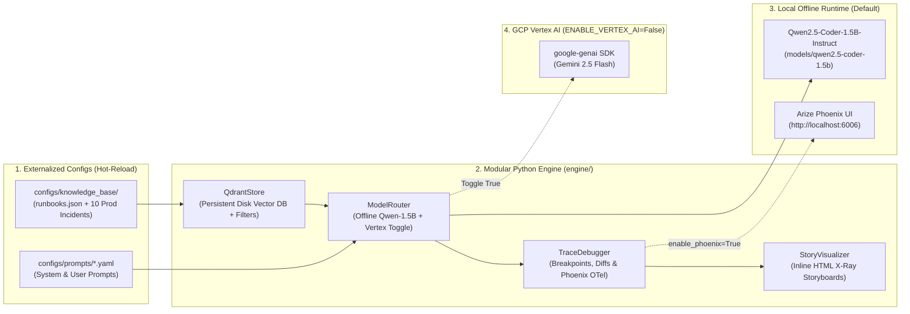
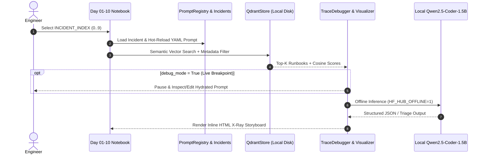

# 🚀 10-Day Rapid Hands-On AI/ML Engineering Bootcamp (Visual Story Edition)

[](LICENSE)
[](https://www.python.org/downloads/)
[](#1-local-windows-setup-point-to-point)
[](#4-optional-gcp-vertex-ai-parity-toggle)

A **zero-configuration, visual, story-driven 10-working-day AI/ML Engineering Bootcamp** designed to take engineers from classical ML baselines to production-grade RAG, QLoRA fine-tuning, Agentic workflows, Guardrails, and FastAPI microservices.

Built around a **Modular `engine/` Architecture**, **Externalized YAML Prompts & 10 Real-World Production Incidents**, **Persistent Qdrant Vector Storage**, and **Inline HTML X-Ray Storyboards + Arize Phoenix Observability**—running **100% offline** on your local machine using local Hugging Face **Qwen2.5-Coder** weights, with a single-flag toggle (`ENABLE_VERTEX_AI = False` by default) for Google Cloud Vertex AI / Gemini parity.

---

## 🏗️ High-Level System & Component Architecture

### 1. End-to-End Visual Story & Hybrid Execution Architecture



### 2. Live Step-Through Debugging & Storyboard Flow



---

## 📂 Repository Structure

```text
aiml_rpd/
├── configs/
│   ├── prompts/                        # Externalized YAML system prompts (hot-reloaded on cell run)
│   │   ├── day03_summarizer.yaml
│   │   ├── day04_json_extractor.yaml
│   │   ├── day05_rag_grounded.yaml
│   │   ├── day08_react_agent.yaml
│   │   └── day09_judge_eval.yaml
│   └── knowledge_base/
│       ├── runbooks.json               # 10 SRE & FinOps runbooks (RB-101 to RB-110)
│       └── incidents_prod_10.json      # 10 realistic multi-signal production incidents
├── engine/
│   ├── __init__.py
│   ├── router.py                       # Offline ModelRouter + LocalEmbedder + Vertex AI guard
│   ├── qdrant_store.py                 # Local persistent Qdrant client + payload filtering
│   ├── prompts.py                      # Disk hot-reloading PromptRegistry & IncidentLoader
│   ├── visualizer.py                   # Inline HTML/SVG X-Ray Pipeline Storyboard renderer
│   └── debugger.py                     # Step-through TraceDebugger + Arize Phoenix exporter
├── notebooks/
│   ├── day01_classical_baseline.ipynb
│   ├── day02_embeddings_mechanics.ipynb
│   ├── day03_llm_inference_engineering.ipynb
│   ├── day04_structured_outputs_tools.ipynb
│   ├── day05_rag_core.ipynb
│   ├── day06_advanced_rag_reranking.ipynb
│   ├── day07_peft_qlora_finetuning.ipynb
│   ├── day08_agentic_workflows.ipynb
│   ├── day09_evals_guardrails.ipynb
│   └── day10_production_deployment.ipynb
├── models/                             # Git-ignored local flat model weights
│   └── qwen2.5-coder-1.5b/
├── qdrant_local_db/                    # Git-ignored persistent local Qdrant storage
├── requirements.txt
├── LICENSE
└── README.md
```

---

## 1. Quickstart & Local Setup

* **Windows Workstation Setup:** Follow the step-by-step [Windows Local Setup & Verification Guide](WINDOWS_SETUP.md) to bootstrap `.venv`, provision offline model weights, run `pytest` across all 60 scenarios, and launch the FastAPI/Gradio console + Arize Phoenix UI (`.\run_local.ps1`).
* **Workshop Slide Deck & Facilitator Guide:** See [WORKSHOP_SLIDES.md](WORKSHOP_SLIDES.md) and [WORKSHOP_GUIDELINE.md](WORKSHOP_GUIDELINE.md).

---

## 2. Live Debugging & Visualization Guide (Point-to-Point)

Every notebook includes built-in visual storytelling and interactive debugging:

1. **Switch Across 10 Production Incidents (`Cell 2`):**
   Change `INCIDENT_INDEX = 0` to any integer from `0` to `9` to test real-world scenarios—including GKE `OOMKilled` (`0`), BigQuery spend spikes (`1`), PgBouncer connection exhaustion with a CPU red herring (`2`), and prompt-injection + leaked token payloads (`5`).

2. **Hot-Reload Externalized System Prompts (`configs/prompts/*.yaml`):**
   * Open any YAML file under `configs/prompts/` (e.g., `configs/prompts/day05_rag_grounded.yaml`).
   * Edit `system_prompt`, `temperature`, or `max_tokens` and save the file.
   * Re-run **Cell 4** (`Shift + Enter`)—`PromptRegistry` reads directly from disk on every execution without needing a kernel restart.

3. **Inspect the Inline HTML X-Ray Storyboard (`Cell 4 Output`):**
   Below Cell 4, `StoryVisualizer` renders a visual flow diagram showing:
   * **Input Incident Metadata & Raw Logs**
   * **Qdrant Retrieval Matches & Cosine Similarity Progress Bars**
   * **Exact Hydrated System + User Prompt Sent to Qwen**
   * **Model Latency (ms) & Structured JSON Output**

4. **Step-Through Snapshot Inspection (`TraceDebugger`):**
   In any cell after running a pipeline, inspect exact inputs, outputs, and latencies of individual stages:
   ```python
   dbg.inspect("qdrant_retrieval")   # Inspect exact retrieved documents & scores
   dbg.inspect("llm_generation")     # Inspect exact prompt & raw model response
   ```

5. **Enable Live Breakpoints (`debug_mode=True`):**
   In **Cell 1**, set `dbg = TraceDebugger(debug_mode=True)` to pause execution right before LLM inference, inspect the retrieved context, and type `c` to continue or `q` to abort.

6. **Launch Arize Phoenix Web UI (`http://localhost:6006`):**
   * **Option A (In-Notebook):** Set `dbg = TraceDebugger(debug_mode=False, enable_phoenix=True)` in **Cell 1** and run the cell.
   * **Option B (Persistent Background Terminal):** Open a second PowerShell window, activate `.venv`, and run:
     ```powershell
     phoenix serve
     ```
   * Open **`http://localhost:6006`** in your browser to view OpenTelemetry trace waterfalls, latency spans, and embedding clusters.

---

## 3. Local Deployment Guide (Day 10 FastAPI Microservice)

To deploy your local hybrid RAG + Qwen triage service as a live REST API on your Windows machine:

1. **Generate the production service script (`app.py`) from Day 10** (or run the FastAPI app directly via Uvicorn):
   ```powershell
   cd C:\python\ai_solutions\aiml_rpd
   .\.venv\Scripts\Activate.ps1
   uvicorn app:app --host 127.0.0.1 --port 8000 --reload
   ```

2. **Access Interactive Swagger API Docs:**
   Open **`http://127.0.0.1:8000/docs`** in your browser to test the `/triage` and `/health` endpoints interactively.

3. **Send a Live `POST` Request via PowerShell:**
   ```powershell
   Invoke-RestMethod -Uri "http://127.0.0.1:8000/triage" `
     -Method POST `
     -ContentType "application/json" `
     -Body '{"incident_id": "INC-LIVE-99", "log_text": "ALERT [P1]: gke-prod-payments OOMKilled exit code 137", "service": "checkout-api"}'
   ```

---

## 4. Testing & Validation Guide (Point-to-Point)

Run these checks to verify offline readiness, notebook gates, and API health:

1. **Verify Hard Offline Isolation (Zero Internet Calls):**
   Confirm `HF_HUB_OFFLINE=1` and `TRANSFORMERS_OFFLINE=1` are active and that `engine/router.py` loads strictly from `C:\python\ai_solutions\aiml_rpd\models\qwen2.5-coder-1.5b`.

2. **Run Day-by-Day Automated Validation Gates (`Cell 6` in Every Notebook):**
   Execute **Cell 6** in each notebook (`day01` through `day10`). Every notebook includes deterministic `assert` gates validating schema keys, Qdrant retrieval relevance, guardrail redaction, and latency thresholds, printing `[PASS]` on success.

3. **Run End-to-End Smoke Tests via `pytest`:**
   ```powershell
   cd C:\python\ai_solutions\aiml_rpd
   .\.venv\Scripts\Activate.ps1
   pytest -v
   ```

4. **Optional GCP Vertex AI Parity Check (`ENABLE_VERTEX_AI = False` by Default):**
   Vertex AI calls are disabled (`ENABLE_VERTEX_AI = False`) across all notebooks. When you are ready to compare local Qwen output against GCP Gemini:
   ```powershell
   gcloud auth application-default login
   $env:GOOGLE_CLOUD_PROJECT = "your-gcp-project-id"
   ```
   Then set `ENABLE_VERTEX_AI = True` in **Cell 1** and run **Cell 5**.

---

## 📅 10-Day Curriculum Overview

| Day | Notebook | Core Concept | Hands-On Deliverable |
| :--- | :--- | :--- | :--- |
| **01** | `day01_classical_baseline.ipynb` | Classical ML Baseline | `TF-IDF + LogisticRegression` severity classifier & latency floor |
| **02** | `day02_embeddings_mechanics.ipynb` | Vector Embeddings & Qdrant | L2-normalized dense embeddings & Qdrant metadata-filtered search |
| **03** | `day03_llm_inference_engineering.ipynb` | Local LLM Inference | Deterministic vs. sampled local `Qwen2.5-Coder-1.5B` benchmarking |
| **04** | `day04_structured_outputs_tools.ipynb` | Structured JSON & Tools | Pydantic schema extraction + Python runbook lookup tool |
| **05** | `day05_rag_core.ipynb` | Grounded RAG Pipeline | End-to-end Qdrant retrieval + YAML-prompted Qwen synthesis |
| **06** | `day06_advanced_rag_reranking.ipynb` | Hybrid Reranking | Dense + lexical fusion reranking to defeat red-herring logs (`INC-2026-003`) |
| **07** | `day07_peft_qlora_finetuning.ipynb` | PEFT / LoRA Mechanics | Instruction dataset builder & LoRA rank/parameter reduction simulation |
| **08** | `day08_agentic_workflows.ipynb` | Multi-Step ReAct Agent | Autonomous tool-routing loop (`check_pod_status` → `search_runbook` → `Qwen`) |
| **09** | `day09_evals_guardrails.ipynb` | Evals & Security Guardrails | Token/PII redaction, prompt-injection defense (`INC-2026-006`) & faithfulness eval |
| **10** | `day10_production_deployment.ipynb` | Production Microservice | FastAPI `/triage` service + automated `TestClient` validation |

---

## 📄 License

This project is licensed under the **Apache License 2.0** — see the [LICENSE.md](LICENSE.md) file for details.